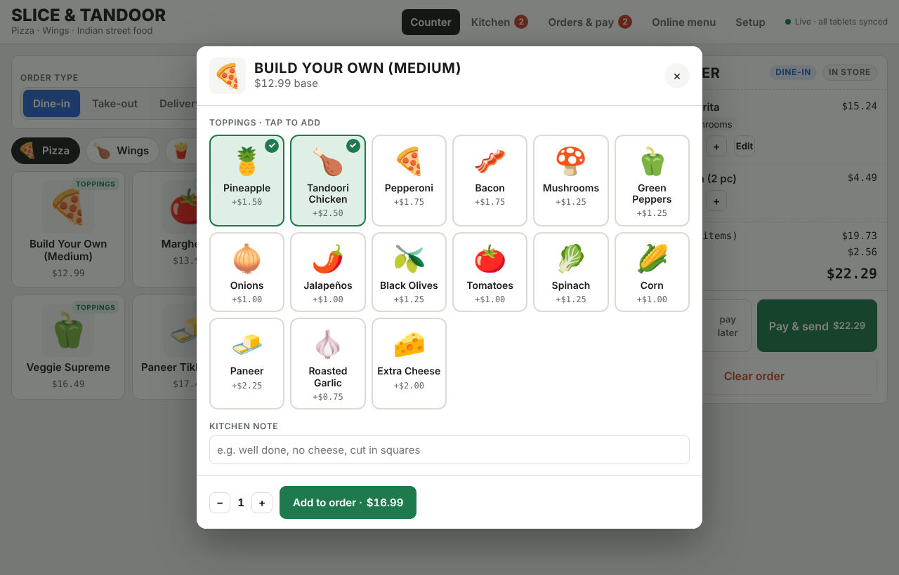
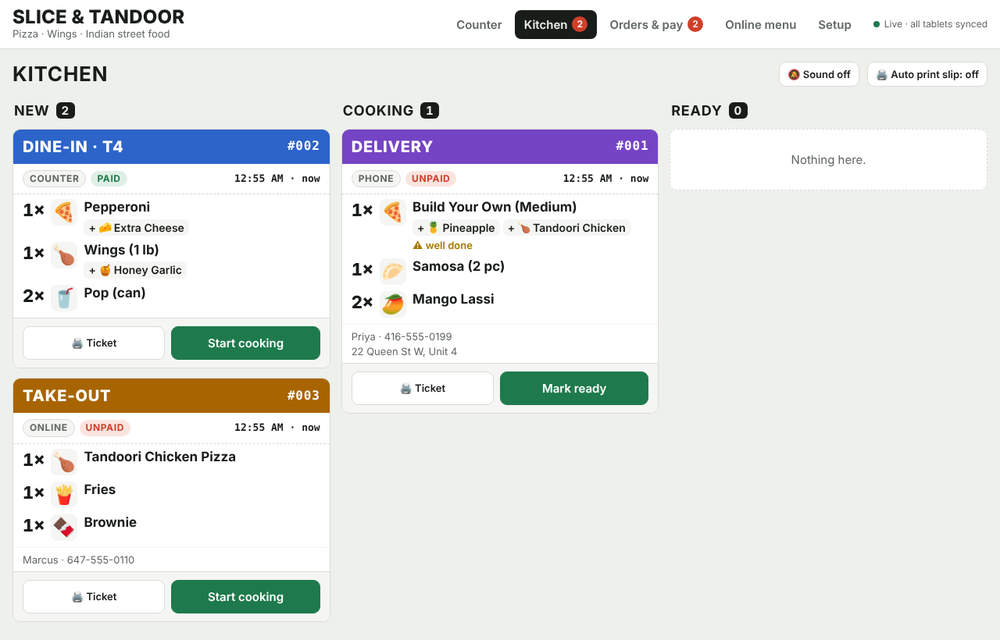
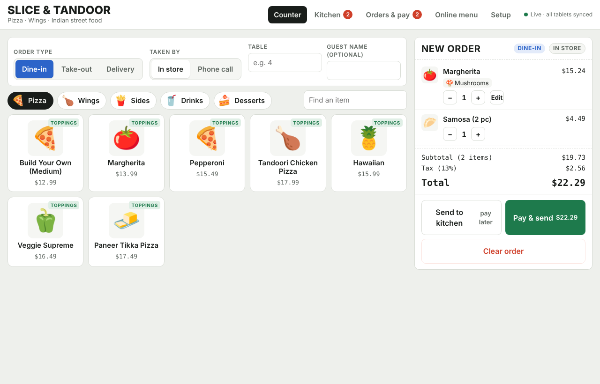
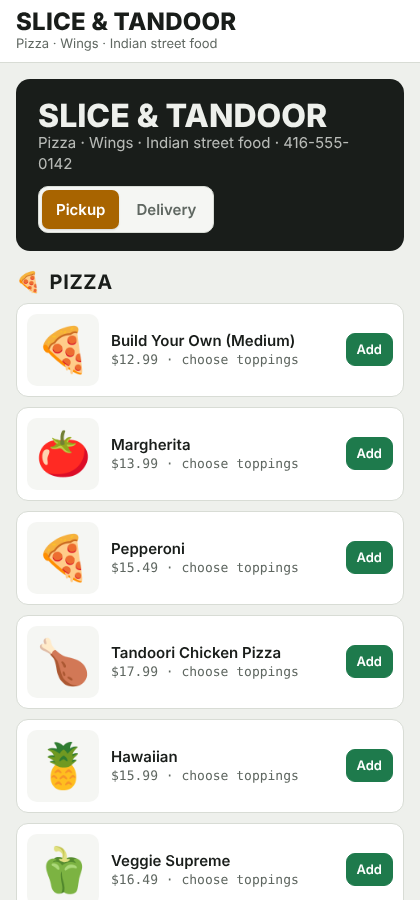

# OrderLine — Restaurant POS

A tablet ordering system any restaurant can adopt. The front counter takes orders from a picture menu, the kitchen tablet gets live tickets and print slips, and customers can order online. Every restaurant sets its own name, menu, prices, tax and pictures.

| Topping picker | Kitchen display |
| --- | --- |
|  |  |
| **Front counter** | **Customer online ordering** |
|  |  |

## Features

**Front counter tablet**
- Picture menu: every item and topping has an icon or a real photo, so staff find items at a glance instead of reading lists.
- Topping picker: a pizza with pineapple and tandoori chicken is two taps on the 🍍 and 🍗 tiles. Wings open a sauce picker the same way.
- Order type on every order: **Dine-in** (table number), **Take-out** (name), **Delivery** (name, phone, address).
- Order source: **In store** or **Phone call**. Website orders are marked **Online**.
- Kitchen notes per item ("well done", "no cheese").
- Payment: cash with change due, card, or gift card. Orders can also be sent to the kitchen first and paid later.

**Kitchen tablet**
- Live tickets in New → Cooking → Ready columns, synced instantly from all devices.
- Colour band per order type: blue dine-in, amber take-out, purple delivery.
- Topping icons, notes, paid/unpaid status, and a timer that turns red after 15 minutes.
- Sound alert and **auto print** for new orders, formatted for an 80 mm receipt printer.

**Online ordering** at `/order`: a customer page with pickup or delivery, cart and checkout.

**Orders & pay**: today's order count, paid sales, money still to collect, and payment for unpaid orders.

**Setup**: restaurant name, tagline, phone, tax %, currency and delivery fee; categories, menu items and toppings, each with an icon or an uploaded photo. A starter menu (pizza, wings and Indian dishes) is included so you can try everything right away.

## Contents

- [How to run it on your computer](#how-to-run-it-on-your-computer)
- [Using the app](#using-the-app)
- [Set it up in a restaurant](#set-it-up-in-a-restaurant)
- [Troubleshooting](#troubleshooting)
- [How it works](#how-it-works)

## How to run it on your computer

### 1. Install Node.js (one time)

The app needs [Node.js](https://nodejs.org) version 18 or newer. Nothing else needs to be installed.

- **Windows / Mac:** download the **LTS** installer from https://nodejs.org and run it with the default options.
- **Linux (Ubuntu/Debian):** `sudo apt install nodejs npm`, or use the installer from nodejs.org.

Check that it worked. Open a terminal (Windows: **Command Prompt** or **PowerShell**; Mac: **Terminal**) and run:

```bash
node --version
```

You should see something like `v22.11.0`. Any version 18 or higher is fine.

### 2. Download the project

**Option A, with Git:**

```bash
git clone https://github.com/SahnavazChoksi/restaurant-pos.git
cd restaurant-pos
```

**Option B, without Git:** on the GitHub page click **Code → Download ZIP**, unzip it, then open a terminal inside the unzipped `restaurant-pos` folder.

> Tip (Windows): open the folder in File Explorer, click the address bar, type `cmd` and press Enter. A terminal opens in that folder.

### 3. Start the app

```bash
npm start
```

You should see:

```
OrderLine POS running on http://localhost:3000
  Counter:  http://localhost:3000/#counter
  Kitchen:  http://localhost:3000/#kitchen
  Online:   http://localhost:3000/order#online
```

The first time it starts, it creates `data/db.json` with the starter menu.

### 4. Open it in your browser

Go to **http://localhost:3000**. Chrome, Edge, Safari and Firefox all work.

| Screen | Address |
| --- | --- |
| Front counter | http://localhost:3000/#counter |
| Kitchen | http://localhost:3000/#kitchen |
| Orders & payments | http://localhost:3000/#orders |
| Online menu (staff preview) | http://localhost:3000/#online |
| Setup | http://localhost:3000/#setup |
| Customer ordering page | http://localhost:3000/order |

To see the live sync, open the **Counter** in one browser window and the **Kitchen** in another, then send an order.

### 5. Stop the app

Press **Ctrl + C** in the terminal. Your menu and orders stay saved in `data/db.json` and come back the next time you run `npm start`.

### Optional settings

| Setting | Default | How to change it |
| --- | --- | --- |
| `PORT` | `3000` | Mac/Linux: `PORT=8080 npm start` · Windows PowerShell: `$env:PORT=8080; npm start` |
| `DATA_DIR` | `./data` | The folder where `db.json` is saved |

## Using the app

**Take an order (Counter)**
1. Choose **Dine-in**, **Take-out** or **Delivery**, and **In store** or **Phone call**.
2. Fill in the table number, or the customer's name, phone and address.
3. Tap a category, then tap items. Items with a **Toppings** badge open the topping picker: tap the icons you want, add a kitchen note if needed, then tap **Add to order**.
4. Tap **Send to kitchen** (pay later) or **Pay & send**.

**Take payment**
- Choose Cash, Card or Gift card. For cash, enter the amount received (or tap a quick amount) to see the change due.
- Unpaid orders can be paid later from **Orders & pay → Take payment**.

**Kitchen**
- New tickets appear in the **New** column. Tap **Start cooking**, then **Mark ready**, then **Served / Picked up / Out for delivery**.
- **🖨️ Ticket** shows the printable slip. Turn on **Sound** and **Auto print slip** on the kitchen tablet.

**Make it your restaurant (Setup)**
1. Enter your restaurant name, tagline, phone, tax %, currency and delivery fee, then tap **Save restaurant**.
2. Add or edit **categories** (for example Burgers, Curries, Drinks).
3. Add **menu items** with a price, a category, and an icon or an uploaded photo.
4. Add **toppings / add-ons** and choose which category they belong to. Items in that category open the topping picker.
5. To remove the sample menu, delete its categories (this deletes their items too).

## Set it up in a restaurant

1. Run the server on one computer in the restaurant (a small PC, laptop or Raspberry Pi).
2. Find its local IP address (for example `192.168.1.20`).
3. On the front tablet, open `http://192.168.1.20:3000/#counter` and add it to the home screen.
4. On the kitchen tablet, open `http://192.168.1.20:3000/#kitchen`, then turn on **Sound** and **Auto print slip**.
5. Open **Setup** and enter the restaurant's name, tax rate and menu.

**Find the computer's IP address**
- Windows: run `ipconfig` and look for **IPv4 Address**.
- Mac: open **System Settings → Wi-Fi → Details**, or run `ipconfig getifaddr en0`.
- Linux: run `hostname -I`.

All tablets must be on the **same Wi-Fi network** as the computer running the server. The first time you start it on Windows, click **Allow access** when the firewall asks.

**Keep it running all day:** leave the terminal open, or use a process manager such as [pm2](https://pm2.keymetrics.io): run `npm install -g pm2`, then `pm2 start server.js --name restaurant-pos`.

### Kitchen printer

The kitchen tablet prints through the browser's normal print system to any 80 mm receipt printer the device can use. For printing with no dialog, run Chrome on the kitchen device in kiosk printing mode:

```bash
chrome --kiosk --kiosk-printing http://192.168.1.20:3000/#kitchen
```

Set the receipt printer as the system's default printer.

## Troubleshooting

| Problem | Fix |
| --- | --- |
| `node` or `npm` is not recognized | Install Node.js (step 1), then close and reopen the terminal. |
| `Error: listen EADDRINUSE ... 3000` | Port 3000 is already in use. Stop the other program, or use another port: `PORT=3001 npm start`. |
| Top-right says **This device only** | The page was opened without the server. Run `npm start` and open the `http://` address, not the HTML file. |
| Top-right says **Reconnecting…** | The server stopped or the Wi-Fi dropped. Run `npm start` again; tablets reconnect on their own. |
| Tablets can't open the page | Put them on the same Wi-Fi, use the computer's IP address (not `localhost`), and allow Node.js through the firewall. |
| No sound in the kitchen | Tap **Sound on** once after opening the page. Browsers only play sound after a tap. |
| Start over with the starter menu | Stop the server, delete the `data` folder, and run `npm start` again. **This also deletes all orders.** |

## How it works

```
public/index.html         The whole app (counter, kitchen, orders, online page, setup)
server.js                 Node.js server: static files, JSON API, live updates
seed/starter-menu.json    Starter menu loaded on first run
data/db.json              Your restaurant's data (created on first run, not committed)
```

- Data is stored in `data/db.json`. Back this file up to keep your menu and order history.
- Tablets receive changes instantly through Server-Sent Events (`/api/events`).
- The server hands out order numbers, so two tablets never create the same number. Numbers restart each day.
- If the page is opened without the server, it still works on that one device using browser storage.

### API

| Method | Route | Purpose |
| --- | --- | --- |
| GET | `/api/state` | Settings, menu and recent orders |
| GET | `/api/events` | Live update stream |
| PUT | `/api/config` | Save restaurant settings and categories |
| PUT | `/api/menu/:id` | Create or update a menu item or topping |
| DELETE | `/api/menu/:id` | Delete a menu item or topping |
| POST | `/api/orders` | Place an order |
| PATCH | `/api/orders/:id` | Update status or record payment |

Settings: `PORT` (default `3000`) and `DATA_DIR` (default `./data`).

## Before using it with real customers

- **Card payments** are recorded, not charged. Connect a payment provider such as Square, Stripe or Moneris to charge cards.
- **Staff login**: there is no password yet. Keep the server on the restaurant's private network, and only expose `/order` to the internet.
- **Hosting the online page** publicly needs HTTPS (for example behind a reverse proxy such as Caddy or Nginx).

## Roadmap ideas

- Staff PIN login and roles
- Card terminal integration
- Daily sales report export
- Item availability toggle ("sold out")
- Table map for dine-in
